  
 
  
 
   
 
    
 

 

 

 <table align="center"> <tr> <td width="50%" align="center"></td> <td width="50%" align="center"></td> </tr> <tr> <td width="50%" align="center"></td> <td width="50%" align="center"></td> </tr> </table> <h2 align="center">🧰 stack</h2> 
  
 <h2 align="center">📊 github stats</h2> 
   
 
<b>Working on something cool? I'd love to hear about it.</b>
 
  
 

